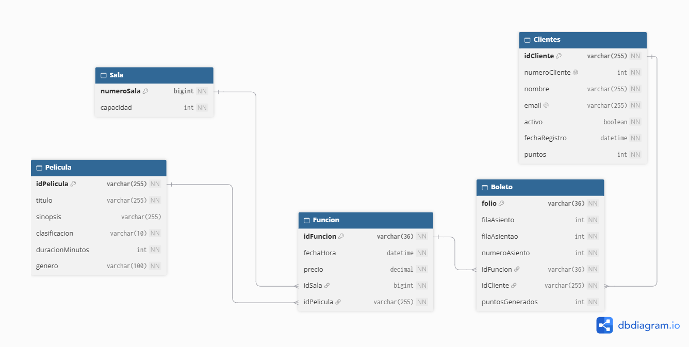

<!-- CORRECCIÓN [112]: README.md actualizado con la especificación completa del Cine "Las Palmas" y DIAGRAMA.png | MOTIVO: Documentación del modelo de referencia, reglas semánticas, endpoints REST y arquitectura -->
# API REST Backend — Cine "Las Palmas"

API REST desarrollada con **Spring Boot 3**, **Spring Data JPA/Hibernate**, **Bean Validation (Jakarta)** y **MySQL** para la gestión y operación del cine "Las Palmas" (único cine con una única sucursal).

El sistema administra la programación de funciones en salas de proyección, el catálogo de películas, la cartera de clientes con acumulación de puntos, y la venta de boletos con validación estricta de capacidad máxima y asignación de asientos únicos.

---

## Diagrama del Modelo de Dominio



---

## Modelo de Dominio y Referencia

### Clases y Atributos

| Entidad | Atributo | Tipo | Naturaleza / Restricción |
|---|---|---|---|
| **Sala** | `numeroSala` | `Long` | **PK**, clave sustituta, autoincremental, no nulo. |
| | `capacidad` | `Integer` | No nulo, mayor a 0. |
| **Pelicula** | `idPelicula` | `String` | **PK**, clave natural (p. ej. `AVE-B15-SU`), no nulo, max 255. |
| | `titulo` | `String` | No nulo, max 255. |
| | `sinopsis` | `String` | Opcional, max 255. |
| | `clasificacion` | `Clasificacion` | Enum (`A`, `B`, `B15`, `C`), `@Enumerated(EnumType.STRING)`, no nulo. |
| | `duracionMinutos` | `Integer` | No nulo, duración en minutos. |
| | `genero` | `String` | No nulo, max 255. |
| **Funcion** | `idFuncion` | `String` | **PK**, clave sustituta UUID, no nulo. |
| | `fechaHora` | `LocalDateTime` | No nulo. |
| | `precio` | `BigDecimal` | No nulo, precisión 10 y escala 2 (`@Column(precision = 10, scale = 2)`). |
| | `sala` | `Sala` | **FK** (`id_sala`), no nulo, relación Many-to-One. |
| | `pelicula` | `Pelicula` | **FK** (`id_pelicula`), no nulo, relación Many-to-One. |
| **Cliente** | `idCliente` | `String` | **PK**, clave natural, no nulo, max 100. |
| | `numeroCliente` | `Integer` | Autoincremental/secuencia única, **NO es PK**. |
| | `nombre` | `String` | No nulo, max 255. |
| | `email` | `String` | No nulo, único, validado con `@Email` (`cadena@dominio.extensión`). |
| | `activo` | `Boolean` | No nulo (default `true`). |
| | `fechaRegistro` | `LocalDateTime` | No nulo. |
| | `puntos` | `Integer` | No nulo, saldo de puntos acumulados. |
| **Boleto** | `folio` | `String` | **PK**, clave sustituta UUID, no nulo. |
| | `filaAsiento` | `Integer` | No nulo, fila del asiento. |
| | `numeroAsiento` | `Integer` | No nulo, número del asiento dentro de la fila. |
| | `funcion` | `Funcion` | **FK** (`id_funcion`), no nulo, relación Many-to-One. |
| | `cliente` | `Cliente` | **FK** (`id_cliente`), no nulo, relación Many-to-One. |
| | `puntosGenerados` | `Integer` | No nulo, puntos otorgados por la compra del boleto. |

---

### Cardinalidades y Asociaciones

1. **Sala 1 : N Funcion**: Una función pertenece a una sola sala de proyección.
2. **Pelicula 1 : N Funcion**: Una función proyecta una sola película.
3. **Funcion 1 : N Boleto**: Los boletos emitidos para una función no pueden exceder la capacidad física de la sala.
4. **Cliente 1 : N Boleto**: Un boleto pertenece a un solo cliente.

---

### Reglas Semánticas y de Negocio Obligatorias

1. **Clasificación Estricta**: La clasificación de películas solo admite los valores `A`, `B`, `B15` y `C`, mapeados como `EnumType.STRING`.
2. **Duración en Minutos**: La duración de las películas se almacena y procesa en minutos en las capas de persistencia y entidades.
3. **Validación de Email**: El correo electrónico de los clientes se valida mediante `@Email` con patrón formal `cadena@dominio.extensión` y unicidad en base de datos.
4. **Manejo Monetario con BigDecimal**: Todos los valores monetarios utilizan `BigDecimal` con precisión 10 y escala 2 explícitas en columnas y cálculos financieros.
5. **Regla de Capacidad Máxima**: No se permite vender más boletos que la capacidad total de la sala correspondiente a la función. Al alcanzar el límite, el sistema rechaza la operación con una excepción de negocio (`BusinessRuleException`).
6. **Regla de Asiento Único por Función**: No puede existir más de un boleto para el mismo asiento (`filaAsiento` + `numeroAsiento`) en la misma función. Esta restricción está garantizada a nivel de servicio y respaldada por una restricción de unicidad compuesta (`uk_boleto_funcion_asiento`) en base de datos.
7. **Acumulación de Puntos**: Cada boleto vendido a un cliente activo genera puntos equivalentes al 10% del precio de la función (redondeo estándar), sumándose al acumulador del cliente.

---

## Arquitectura del Proyecto

El proyecto sigue una arquitectura en capas clara sin dependencias circulares ni DTOs innecesarios:

```
src/main/java/com/cine/
├── CineApplication.java           # Clase principal de arranque Spring Boot
├── controllers/                   # Controladores REST con respuestas HTTP y ResponseEntity
│   ├── BoletoController.java
│   ├── ClienteController.java
│   ├── FuncionController.java
│   ├── PeliculaController.java
│   └── SalaController.java
├── exceptions/                    # Manejo global centralizado de excepciones
│   ├── BusinessRuleException.java
│   ├── GlobalExceptionHandler.java
│   └── ResourceNotFoundException.java
├── models/                        # Entidades JPA del dominio con Bean Validation
│   ├── Boleto.java
│   ├── Clasificacion.java
│   ├── Cliente.java
│   ├── Funcion.java
│   ├── Pelicula.java
│   └── Sala.java
├── repositories/                  # Repositorios Spring Data JPA
│   ├── BoletoRepository.java
│   ├── ClienteRepository.java
│   ├── FuncionRepository.java
│   ├── PeliculaRepository.java
│   └── SalaRepository.java
└── services/                      # Lógica de negocio y control transaccional
    ├── BoletoService.java
    ├── ClienteService.java
    ├── FuncionService.java
    ├── PeliculaService.java
    └── SalaService.java
```

---

## Endpoints de la API REST

### 1. Salas (`/salas`)

- `GET /salas`: Lista todas las salas.
- `GET /salas/{numeroSala}`: Obtiene una sala por su número (PK).
- `POST /salas`: Registra una nueva sala enviando el cuerpo JSON:
  ```json
  {
    "capacidad": 120
  }
  ```

---

### 2. Películas (`/peliculas`)

- `GET /peliculas`: Lista todas las películas.
- `GET /peliculas?clasificacion=B15`: Filtra películas por clasificación (`A`, `B`, `B15`, `C`).
- `GET /peliculas/{idPelicula}`: Obtiene el detalle de una película por su ID natural.
- `POST /peliculas`: Registra una nueva película:
  ```json
  {
    "idPelicula": "AVE-B15-SU",
    "titulo": "Avengers Doomsday",
    "sinopsis": "Los héroes más poderosos se enfrentan a una nueva amenaza.",
    "clasificacion": "B15",
    "duracionMinutos": 150,
    "genero": "Superheroes"
  }
  ```

---

### 3. Clientes (`/clientes`)

- `GET /clientes`: Lista todos los clientes registrados.
- `GET /clientes/{idCliente}`: Obtiene la información de un cliente por su ID.
- `GET /clientes/{idCliente}/puntos`: Consulta el saldo actual de puntos acumulados.
- `POST /clientes`: Registra un nuevo cliente:
  ```json
  {
    "idCliente": "CLI-2026-001",
    "nombre": "Gerardo Chelius",
    "email": "chelius@ejemplo.com",
    "activo": true
  }
  ```

---

### 4. Funciones (`/funciones`)

- `GET /funciones`: Lista todas las funciones con su sala y película anidadas.
- `GET /funciones/{idFuncion}`: Obtiene el detalle de una función específica.
- `POST /funciones`: Programa una nueva función con los parámetros:
  - `idPelicula` (String): ID de la película existente.
  - `idSala` (Long): Número de la sala existente.
  - `fechaHora` (ISO-8601): P. ej. `2026-11-01T19:30:00`.
  - `precio` (BigDecimal): P. ej. `85.00`.

#### Representación JSON Anidada de Ejemplo (`Funcion`)

```json
{
  "idFuncion": "8f8b8bb1-e37d-4171-8bc6-a94f6c5fa57c",
  "fechaHora": "2026-11-01T19:30:00",
  "precio": 85.00,
  "sala": {
    "numeroSala": 1,
    "capacidad": 120
  },
  "pelicula": {
    "idPelicula": "AVE-B15-SU",
    "titulo": "Avengers Doomsday",
    "sinopsis": "Los queridos héroes de tres universos distintos van a quedar atrapados en una colisión mortal y se van a enfrentar a una amenaza existencial.",
    "clasificacion": "B15",
    "duracionMinutos": 150,
    "genero": "Superheroes"
  }
}
```

---

### 5. Boletos (`/boletos`)

- `GET /boletos/funcion/{funcionId}`: Lista todos los boletos vendidos para una función dada.
- `POST /boletos`: Compra un boleto validando capacidad disponible y asiento único:
  - `idFuncion` (String): UUID de la función.
  - `idCliente` (String): ID del cliente comprador.
  - `filaAsiento` (Integer): Fila elegida.
  - `numeroAsiento` (Integer): Número de asiento elegido.

**Respuesta de compra (`201 Created`):**
```json
{
  "folio": "c5d1947b-1cb8-4720-96b6-9799eebe1f2e",
  "filaAsiento": 1,
  "numeroAsiento": 5,
  "funcion": { ... },
  "cliente": { ... },
  "puntosGenerados": 9
}
```

---

## Configuración y Variables de Entorno

La conexión a la base de datos se configura mediante un archivo `.env` en la raíz del proyecto:

```properties
DB_URL=jdbc:mysql://localhost:3306/cine?createDatabaseIfNotExist=true&useSSL=false&allowPublicKeyRetrieval=true&serverTimezone=America/Mexico_City
DB_USERNAME=root
DB_PASSWORD=tu_password
```

Puerto por defecto: `server.port=6767`.

---

## Instalación y Ejecución Paso a Paso

### 1. Clonar el Repositorio
```bash
git clone https://github.com/G-Chelius-A/Cine-SOA
cd Cine-SOA
```

### 2. Requisitos Previos
- **Java 21 LTS** o superior (`java -version`).
- **MySQL 8.0+** en ejecución local o remota.
- Terminal compatible con Bash o PowerShell.

### 3. Configurar Base de Datos y Variables de Entorno
Crea o edita el archivo `.env` en la raíz del proyecto con los parámetros de conexión a MySQL (puedes basarte en `.env.example`):
```properties
DB_URL=jdbc:mysql://localhost:3306/cine?createDatabaseIfNotExist=true&useSSL=false&allowPublicKeyRetrieval=true&serverTimezone=America/Mexico_City
DB_USERNAME=root
DB_PASSWORD=tu_password
```
> *Nota*: El puerto HTTP predeterminado del servidor es `6767`.

### 4. Compilar el Proyecto (si no es con el triángulo de los IDEs como VSCode)
Para descargar dependencias y compilar el código fuente:
```powershell
# En Windows (PowerShell / CMD)
.\mvnw.cmd clean compile

# En Linux / macOS
./mvnw clean compile
```

### 5. Ejecutar la Aplicación
Para iniciar el servidor Spring Boot en desarrollo:
```powershell
# En Windows (PowerShell / CMD)
.\mvnw.cmd spring-boot:run

# En Linux / macOS
./mvnw spring-boot:run
```
El servicio estará disponible en: `http://localhost:6767`

Para empaquetar y ejecutar como JAR autónomo en producción:
```powershell
# Empaquetar
.\mvnw.cmd clean package -DskipTests

# Ejecutar JAR
java -jar target/cine-0.0.1-SNAPSHOT.jar
```

---

## Ejecución de Pruebas

Para correr la suite de pruebas unitarias y de validaciones:
```powershell
# En Windows (PowerShell / CMD)
.\mvnw.cmd test

# En Linux / macOS
./mvnw test
```

### Cobertura de Pruebas
- **`BoletoServiceTest`**:
  - Exceder la capacidad de la sala lanza `BusinessRuleException`.
  - Intentar reservar un asiento duplicado en la misma función lanza `BusinessRuleException`.
  - Compra exitosa genera folio UUID, asigna asiento y acumula puntos en el cliente.
- **`ValidationTest`**:
  - Validación formal de correo electrónico (`@Email`) con formato `cadena@dominio.extensión`.
  - Restricción estricta de valores permitidos para el enum `Clasificacion` (`A`, `B`, `B15`, `C`).
  - Validación de campos requeridos y duraciones mayores a 0 en películas.
- **`CineApplicationTests`**:
  - Verificación de arranque y carga de clases base.

---

## Pruebas en Postman

El proyecto incluye el archivo [`postman_collection.json`](postman_collection.json) listo para ser importado directamente en Postman (**File > Import** o botón **Import**).

La colección incluye variables automáticas (`{{baseUrl}} = http://localhost:6767` y `{{idFuncion}}`) y las peticiones organizadas para validar el flujo completo y las reglas de negocio:

1. **Salas**: Creación de sala con capacidad reducida (2 asientos) para probar los límites.
2. **Películas**:
   - Creación exitosa con clasificación `B15`.
   - Prueba de validación fallida con clasificación no permitida `ATP` (`400 Bad Request`).
3. **Clientes**:
   - Registro exitoso con email válido.
   - Prueba de validación fallida con email inválido sin dominio (`400 Bad Request`).
4. **Funciones**:
   - Programación de función con fecha/hora ISO y precio en `BigDecimal`, devolviendo el JSON anidado con su película y sala.
5. **Boletos y Reglas de Negocio**:
   - Compra de boleto 1 (Fila 1 Asiento 1) -> Generación de folio UUID y acumulación de puntos.
   - **Regla 6 (Asiento Único)**: Intento de comprar el mismo asiento (Fila 1 Asiento 1) -> `400 Bad Request` ("asiento ya reservado").
   - Compra de boleto 2 (Fila 1 Asiento 2) -> Sala llega a su capacidad máxima (2).
   - **Regla 5 (Capacidad Máxima)**: Intento de comprar boleto 3 (Fila 1 Asiento 3) -> `400 Bad Request` ("la sala ha alcanzado su capacidad máxima").
